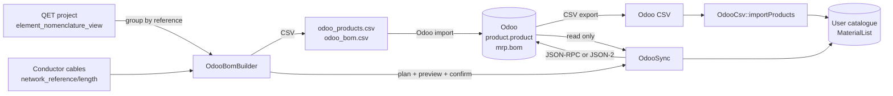

# Exchanging bills of materials with Odoo

QElectroTech can export the bill of materials (BOM) of a project to Odoo and
read product data (designation, price, stock, vendor) back from Odoo into a
user catalogue. Two ways exist:

1. **CSV files**, usable without any connection. The files follow the
   column names of Odoo's native import.
2. **The Odoo external API**, on request, with a preview and a confirmation
   before anything is written. The mode is *simulation* by default.

The feature lives in `sources/odoo/` and is opened from
*Project > Exchange with Odoo...*. The menu entry only adds a command: no
existing behaviour changes, so it has no setting.

## Flow



## What is exchanged

- **Products**: one per internal reference (`default_code`), with name,
  cost, manufacturer and vendor. Components are grouped by their
  *manufacturer reference*. Components without a reference are not exported
  (the count is shown).
- **Bills of materials** (`mrp.bom` and `mrp.bom.line`): one for the project,
  or one per cabinet when "One bill of materials per cabinet" is ticked. The
  cabinet is the `location` of the element, so it is filled when the
  enclosure-layout work is present (otherwise lines go to `unassigned`).
- **Cables**: when ticked, the conductors carrying `network_reference`,
  `network_length` and `network_cable` (network-cables work) add one line per
  cable reference, with the **total length in metres**.
- **Code of a BOM**: `QET-<project>` and `QET-<project>-<cabinet>` (names
  are reduced to letters, digits and dashes).

If Odoo has no `mrp.bom` model (Manufacturing is not installed), only the
products are exchanged and the plan says so.

## CSV

CLI, without opening the interface:

```
qelectrotech --export-odoo project.qet outdir [--odoo-per-cabinet]
             [--odoo-cables] [--odoo-mapping=mapping.json]
```

It writes `odoo_products.csv` and `odoo_bom.csv`. In Odoo: *Inventory >
Products > Favorites > Import records*, then *Manufacturing > Bills of
Materials > Import records*. Import the products first.

Default columns:

| File | Columns |
| --- | --- |
| `odoo_products.csv` | `default_code`, `name`, `standard_price`, `description_purchase` (manufacturer), `seller_ids/partner_id`, `seller_ids/product_code` |
| `odoo_bom.csv` | `product_tmpl_id`, `code`, `product_qty`, `type`, `bom_line_ids/product_id`, `bom_line_ids/product_qty` |

In `odoo_bom.csv` the first row of a BOM carries the header fields; the next
rows only carry the line columns, as Odoo expects.

Import of a CSV exported by Odoo (*Odoo > Export*, any language of the
usual column titles) into the catalogue: the dialog reads `default_code`,
`name`, `standard_price`, the vendor, the manufacturer or purchase
description, and `qty_available`. A CSV with BOM, `;` or `,`, quoted
multi-line cells is read. Rows without a reference are skipped and duplicated
references are reported; the first one wins. The catalogue file is saved with
a backup (`.bak`) beforehand. Either *fill empty cells* or *overwrite* can be
chosen, after a preview.

## Column mapping (JSON)

`--odoo-mapping` and the *Content* tab load a JSON file. It only has to list
what it changes; "Save the default mapping..." writes the complete one.

```json
{
  "version": 1,
  "csv": {
    "separator": ",",
    "utf8_bom": false,
    "bom_type": "normal",
    "products": [
      {"column": "default_code", "value": "{reference}"},
      {"column": "name", "value": "{name}"},
      {"column": "seller_ids/partner_id", "value": "{supplier}",
       "only_if": "supplier"}
    ],
    "bom_header": [
      {"column": "code", "value": "{bom_code}"},
      {"column": "product_qty", "value": "1"}
    ],
    "bom_line": [
      {"column": "bom_line_ids/product_id", "value": "{reference}"},
      {"column": "bom_line_ids/product_qty", "value": "{quantity}"}
    ]
  },
  "import": {
    "manufacturer_reference": ["default_code", "Internal Reference"],
    "designation": ["name", "Name"],
    "unit_price": ["standard_price", "Cost"]
  },
  "api": {
    "product_fields": [
      {"field": "name", "value": "{name}", "type": "string",
       "update": "fill_empty"}
    ],
    "pull_fields": [
      {"odoo": "standard_price", "column": "unit_price"}
    ]
  }
}
```

- A list (`products`, `bom_header`, `bom_line`, `product_fields`,
  `pull_fields`) replaces the default list; set `"enabled": false` on an
  entry to drop a column.
- `only_if` leaves the cell empty when the named value is empty.
- `import` maps a catalogue column to the possible headers of the Odoo file
  (the first header found is used).
- `update` is `never`, `fill_empty` (default) or `overwrite`: it tells what
  happens to a field of an Odoo product that already exists.
  `default_code` is never updated.
- `type` is `string` or `float`.
- Placeholders: `{reference}`, `{name}`, `{manufacturer}`, `{supplier}`,
  `{unit}`, `{quantity}`, `{price}`, `{cabinet}`, `{labels}`,
  `{bom_product}`, `{bom_code}`, `{bom_name}`, `{bom_type}`, `{project}`.
- A broken file is refused with a message; the default mapping is then used.

## API connection

Defaults (editable): address `https://mcatech.odoo.com`, database `mcatech`
(on Odoo Online the database name is normally the sub-domain). Enter the
login (e-mail) and an **API key** created in Odoo under *My Profile >
Account Security > New API Key*. The password of the account is never used.

Protocols, behind one interface (`OdooClient`):

| Protocol | Endpoint | Odoo |
| --- | --- | --- |
| JSON-RPC | `/jsonrpc` | 17, 18 (and 19, deprecated) |
| JSON-2 | `/json/2/<model>/<method>` | 19 and later |
| Automatic (default) | JSON-2, falling back to JSON-RPC if the server answers 404 | any |

"Test the connection" checks the key with a read-only request.

### Operations

*Odoo > Preview QElectroTech -> Odoo* reads Odoo (nothing is written) and
lists, per product, *create* or the fields that would be updated, then the
BOM. In **simulation** (default) the *Apply* button only reports what it would
do and sends no request. After the box is unticked, *Apply to Odoo* asks for a
confirmation, then:

1. creates the missing products (`default_code` is the key) and updates the
   fields allowed by the mapping;
2. creates the BOM, or completes an existing one with the lines it lacks.
   Quantities of lines already in Odoo are set to the QElectroTech quantity
   (shown as an update in the preview); extra lines in Odoo are reported and
   left alone.

*Preview Odoo -> QElectroTech* reads, for the references of the project,
`name`, `standard_price`, `qty_available` and the vendor (first
`product.supplierinfo`), then fills the catalogue (empty cells or overwrite).
Both directions stop at the first error and report it. **Nothing is ever
deleted in Odoo**: the client has no delete method and refuses `unlink`.

The vendor must already exist in Odoo to be linked (it is not created).

## Security of the API key

- The key is **never** written in the `.qet` project, in the settings
  (`QSettings` only stores URL, database, login and protocol), in the
  repository, nor in a log or error message (it is replaced by `***`).
- Either the key is typed at each session, or the "Remember" box stores it in
  the system vault: **Windows Credential Manager** on Windows (entry
  `QElectroTech/Odoo/<host>|<login>`). Where no vault is implemented, the key
  is only kept in memory for the session and the box says so.
- Plain `http` is refused, except for `localhost`/`127.0.0.1` (tests).
  Redirects are not followed, so the key cannot be sent elsewhere.
- Use a dedicated Odoo user with minimal rights (read on products and
  vendors, create/write on products and BOMs).

## Limits by Odoo version and plan

- The external API is available on **Odoo Online only with the Custom plan**
  (and on Odoo.sh / on-premise). The *One App Free* and *Standard* plans have
  no access. `mcatech.odoo.com` is an Odoo Online address: the API is exposed
  on `*.odoo.com` for a Custom plan.
- JSON-2 (`/json/2`) exists from Odoo 19. `/jsonrpc` and `/xmlrpc` are
  deprecated: Odoo announces the removal of the `common` and `object`
  services in Odoo 22 (Online 21.1), and of the `db` service in Odoo 20
  (Online 19.1). QElectroTech uses neither the `db` service nor the
  database list; the database name must be typed.
- JSON-2 returns an error as HTTP 4xx, which is shown as it is.
- Without the Manufacturing app, `mrp.bom` does not exist: only products.
  The type of BOM is the one of `bom_type` (default `normal`).
- The fields come from standard Odoo (`default_code`, `standard_price`,
  `description_purchase`, `seller_ids`). Custom fields or studio fields
  require editing the mapping.
- Product variants, units of measure other than "Units", multi-company and
  price lists are not handled. The quantity of a cable line is in metres, so
  the product must use a length unit in Odoo to be meaningful.
- The cabinet and cable data come from attributes saved by other QElectroTech
  branches (`location`, `network_*`); without them these parts stay empty.

## Tests

`tests/qttest/tst_odoocsv.cpp` (grouping, CSV, mapping, import, merge) and
`tests/qttest/tst_odooapi.cpp` (JSON-RPC and JSON-2 against a fake Odoo that
listens on `127.0.0.1`; wrong key; absence of Manufacturing; simulation sends
nothing; no `unlink`; the key does not leak into settings or messages). **No
test contacts a real Odoo.**

The real Odoo instance was not reachable during the development: the first
real run is yours, in simulation mode.
